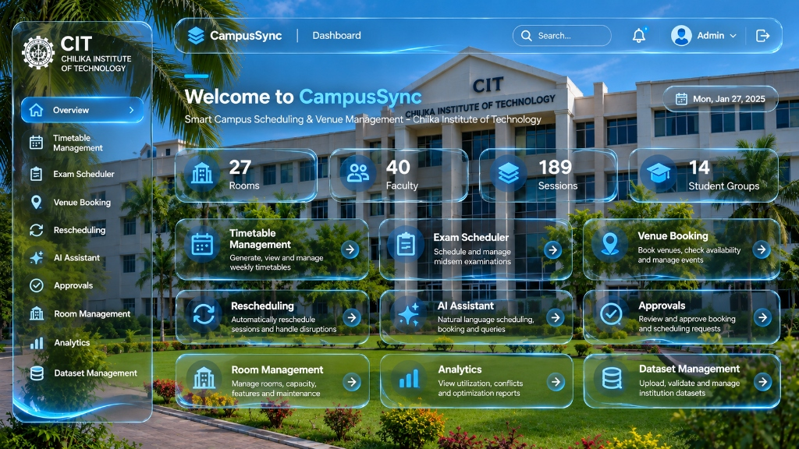

# CampusSync – Chilika Institute of Technology (CIT)
### Smart Campus Scheduling & Venue Management System
**IIT Bhubaneswar Web Hackathon Entry**

A cinematic, liquid-transparent glassmorphism web platform designed and engineered for **Chilika Institute of Technology (CIT)**.



---

## 🌟 Key Highlights

### 1. Cinematic CIT Login Gateway
- **Realistic CIT Campus Background**: Features the actual Chilika Institute of Technology campus architecture, rotunda, and fountain.
- **Ultra-Transparent Liquid Glassmorphism**: High-transparency crystal glass with Apple VisionOS-style refraction, specular highlights, and zero murky dark overlays.
- **Micro-Animations (GSAP)**:
  - Atmospheric floating light particles via HTML5 canvas.
  - Camera-like subtle zoom and responsive mouse parallax (respects `prefers-reduced-motion`).
  - Staggered form field entrance and interactive hover glows.
- **Role-Based Authentication**:
  - **Admin**: `admin@cit.ac.in` / `Admin@Cit2026`
  - **Department Coordinator**: `coordinator.cse@cit.ac.in` / `Coord@Cse2026`
  - **Faculty**: `faculty.sharma@cit.ac.in` / `Faculty@Cit2026`
  - **Club Representative**: `zephyr.club@cit.ac.in` / `Zephyr@Cit2026`
  - Quick-fill role switcher tabs for instant testing.

### 2. Exact Reference Dashboard (Liquid Blue & Cyan Glass)
Recreated directly from the reference design with:
- **Top Navigation Bar**: Floating glass navbar with CampusSync branding, search pill, notification popover with active badges, dynamic role switcher, and logout trigger.
- **Left Sidebar**: Tall glass sidebar with official circular CIT university seal, 10 role-filtered navigation modules, and a bottom luminous wave refraction SVG.
- **Hero Area**: Cyan accent pillar with live formatted date pill.
- **4 Statistics Cards**:
  - `27 Rooms` (Building icon in cyan/blue glowing badge)
  - `40 Faculty` (Users icon)
  - `189 Sessions` (Layers icon)
  - `14 Student Groups` (Graduation cap icon)
- **3x3 Grid of 9 Feature Cards**:
  1. **Timetable Management** – Generate, view and manage weekly timetables.
  2. **Exam Scheduler** – Schedule and manage midsem examinations.
  3. **Venue Booking** – Book venues, check availability and manage events.
  4. **Rescheduling** – Automatically reschedule sessions and handle disruptions.
  5. **AI Assistant** – Natural language scheduling, booking and queries.
  6. **Approvals** – Review and approve booking and scheduling requests (**anti-self-approval rule enforced**).
  7. **Room Management** – Manage 27 campus rooms, capacity, features and telemetry.
  8. **Analytics** – View block utilization, conflicts and optimization reports.
  9. **Dataset Management** – Upload, validate and manage institution datasets.

### 3. Dedicated Interactive Module Pages
Every card and sidebar option routes to its own fully functional, responsive module:
- `/` or `/login`: Unauthenticated users land on the cinematic login gateway.
- `/dashboard`: Overview dashboard matching reference layout.
- `/timetable`: Day tabs (Mon-Sat), section filters (CSE-3A, CSE-5B), and real-time schedule grid.
- `/exam-scheduler`: Midsem and Endsem seating plans and block allocations.
- `/venue-booking`: Auditorium & lab booking form with instant status pipeline.
- `/rescheduling`: AI clash resolution engine proposing slot swaps.
- `/ai-assistant`: Conversational assistant for natural language scheduling queries.
- `/approvals`: Role-protected request management with anti-self-approval validation.
- `/rooms`: 27-room telemetry catalog with AC, projector, and capacity indicators.
- `/analytics`: Block utilization bars and UGC faculty workload tracker.
- `/datasets`: CSV/JSON institutional dataset upload and schema validator.

---

## 🛠️ Technology Stack

- **Framework**: React 19 + Vite 6
- **Language**: TypeScript
- **Styling**: Tailwind CSS + Custom Liquid Glassmorphism Tokens
- **Animations**: GSAP (GreenSock Animation Platform)
- **Icons**: Lucide React
- **Routing**: React Router v7

---

## 🚀 Getting Started

### Prerequisites
- Node.js (v18+)
- npm

### Installation

```bash
# Clone the repository
git clone https://github.com/abhinavmishra306500-glitch/webhackathon-iitbbsr.git

# Navigate into project directory
cd webhackathon-iitbbsr

# Install dependencies
npm install

# Start Vite development server
npm run dev
```

Open [http://localhost:5173](http://localhost:5173) in your browser.

### Production Build

```bash
npm run build
```

---

## 🏛️ Institution
**Chilika Institute of Technology (CIT)**  
Autonomous Institution • NAAC A++ Accredited • Academic Session 2026–2027
