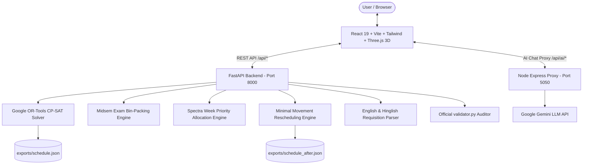

# CampusSync – Chilika Institute of Technology (CIT)
### Smart Campus Scheduling, Midsem Examination & Venue Management Platform
**Official Submission for Web Hackathon**

---

## 🏛️ System Architecture



---

## 🌟 10 Core Capabilities (Full Problem Statement Compliance)

1. **Clash-Free Timetable Generation (OR-Tools CP-SAT):**
   - Formulates all 189 sessions (243 weekly teaching hours) across 27 rooms and 40 faculty.
   - Enforces all **Hard Constraints** (`H1`–`H14`): faculty/group/room non-overlap, lab start periods (P2 or P6 only, 3 hours), lunch boundary (no crossing between P5 and P6), wheelchair accessibility (`H10`), elective basket slot parallel synchronization (`H11`), and faculty daily limit (max 4 hours/day `H12`).
   - Minimizes soft penalties (`S1`–`S6`).
   - **Validator Result: ZERO Hard Violations (`H1-H14: 0`).**

2. **Midsem Examination Scheduling:**
   - 41 midsem exams scheduled across exam week (`MON`–`SAT`) in `AM` (09:30–11:30) and `PM` (14:00–16:00).
   - Enforces **Half-Capacity Rule** (`H5`): effective room capacity is halved (`capacity // 2`).
   - Multi-room aggregation ensures `sum(half_cap) >= exam.size`.
   - Rooms strictly validated for `"exam"` in `allowed_uses` (`E2`). Zero group clashes.
   - **Validator Result: ZERO Hard Violations (`E1, E2, H3, H4, H5: 0`).**

3. **Natural Language Venue Requisition (English & Hinglish):**
   - Parses colloquial English and Hinglish requests (e.g. *"seminar hall kal shaam 6 baje, 2 ghante, 100 log, mic chahiye"*).
   - Maps Hindi relative day `"kal"` to tomorrow, 6 PM to period `P10`, mic to `pa_system`.
   - Identifies conflicts proactively (e.g. wheelchair access requested but named room `SH-2` is not accessible, suggests `SH-1`).
   - Generates structured draft for user review and editing before final submission.

4. **Spectra Week (Week 7) Priority-Based Booking Decisions:**
   - Evaluates all 25 booking requests against hierarchical priority order:
     `exam > regular_session > institute_event (5) > guest_lecture (4) > department_event (3) > club_event (2)`.
   - Enforces **Role Category Capping** (e.g. club rep cannot claim institute event status).
   - Tie-breaks via earlier submission timestamp.
   - Automatically rejects officially withdrawn requests (`BR-04` / `cancellations.csv`).
   - Generates meaningful decision reasons for approvals, alternatives, and rejections.
   - **Zero Priority Inversions** verified by official validator.

5. **Disruption Handling & Minimal Movement Rescheduling:**
   - Ingests `sample_disruption.json` (faculty leave, room maintenance closure, session additions/removals).
   - Employs stability optimization in CP-SAT to move the **fewest possible sessions**.
   - **Result: Only 14 sessions moved out of 189** (175 sessions preserved in their exact original slot).
   - Generates exact side-by-side diff requiring explicit Human Admin approval.

6. **Multi-Dimensional Timetable Views & Room Telemetry:**
   - Interactive timetable viewable by **Student Group** (e.g. `CSE-3`, `ECE-2`), by **Faculty** (e.g. `Dr. Manoranjan Sharma`), or by **Room** (e.g. `LH-1`).
   - Real-time room telemetry across all 27 campus rooms with capacity, AC, projector, and equipment indicators.

7. **Advisory AI Assistant (Google Gemini):**
   - Natural language conversational assistant grounded with official `cit_public.json` entities.
   - Strictly advisory: cannot autonomously approve bookings or mutate timetables. All actions require deterministic backend validation.

8. **Decision Explanation Engine:**
   - Explains scheduling rationale (e.g. why classes start at 8 AM, why `BR-09` for 1,200 seats was rejected, why `BR-04` was rejected due to withdrawal).

9. **Official Validator & Schedule Exports:**
   - Generated files committed to repository:
     - `exports/schedule.json`
     - `exports/schedule_after.json`
   - Integrated with official `validator.py` via API and CLI.

10. **Authorized Manual Scheduling:**
    - Authorized roles can manually schedule events with real-time validation against all hard constraints.

---

## 👥 Demo Accounts (All 4 Roles)

| Role | Email | Password | Primary Permissions |
| :--- | :--- | :--- | :--- |
| **Admin (Dean's Office)** | `admin@cit.ac.in` | `Admin@Cit2026` | Full platform control, timetable generation, disruption approval, demo data reset. |
| **Department Coordinator** | `coordinator.cse@cit.ac.in` | `Coord@Cse2026` | Department session change requests, lab booking approvals, midsem hall oversight. |
| **Faculty Member** | `faculty.sharma@cit.ac.in` | `Faculty@Cit2026` | Personal schedule view, leave/unavailability declaration, swap requests. |
| **Club Representative** | `zephyr.club@cit.ac.in` | `Zephyr@Cit2026` | Venue requisition submission, cancellation, status tracking. |

> **Judge Quick-Fill:** On the login page ([http://localhost:5180/login](http://localhost:5180/login)), click any role tab (Admin, Coordinator, Faculty, Club Rep) to instantly populate working demo credentials.

---

## 🚀 Setup & Execution Guide

### Prerequisites
- Python 3.10+ / 3.11+
- Node.js 18+ / 20+

### 1. Clone & Install Dependencies
```bash
# Clone repository
git clone https://github.com/abhinavmishra306500-glitch/webhackathon-iitbbsr.git
cd webhackathon-iitbbsr

# Frontend & Node proxy dependencies
npm install

# Python virtual environment
python3 -m venv .venv
source .venv/bin/activate
pip install ortools fastapi uvicorn pydantic python-dotenv requests pytest sqlalchemy httpx
```

### 2. Configure Environment Variables
Copy template `.env.example` to `.env`:
```bash
cp .env.example .env
```
Ensure `.env` contains:
```env
AI_API_KEY=your_gemini_api_key
AI_PROVIDER=google_gemini
AI_BASE_URL=https://generativelanguage.googleapis.com/v1beta
AI_MODEL=gemini-3.1-flash-lite-preview
PORT=5050
```

### 3. Run Applications
```bash
# Terminal 1: FastAPI Core Engine (Port 8000)
.venv/bin/python -m uvicorn backend.main:app --host 0.0.0.0 --port 8000

# Terminal 2: AI Node Proxy (Port 5050)
node server/index.js

# Terminal 3: Liquid Glass Frontend (Port 5180)
npm run dev -- --port 5180
```
Open **[http://localhost:5180](http://localhost:5180)** in your browser.

---

## 🧪 Automated Testing & Validation

### Run Pytest Test Suite:
```bash
.venv/bin/pytest tests/test_backend.py -v
```
*(10 of 10 tests passing across all capabilities)*

### Run Official Validator:
```bash
# Baseline Schedule Validation
python3 CrunchWeek_StarterPack/validator.py \
  --data CrunchWeek_StarterPack/data/cit_public.json \
  --schedule exports/schedule.json

# Disrupted Schedule Validation
python3 CrunchWeek_StarterPack/validator.py \
  --data CrunchWeek_StarterPack/data/cit_public.json \
  --schedule exports/schedule_after.json \
  --disruption CrunchWeek_StarterPack/examples/sample_disruption.json \
  --baseline exports/schedule.json
```

**Official Validator Output:**
```
Dataset: cit-public-v1   Schedule says: cit-public-v1   Team: TechZephyr CIT
Hard violations: 0  {}
Soft penalty: 346  {'S1': 0, 'S2': 70, 'S3': 93, 'S4': 183, 'S5': 0, 'S6': 0}
Bookings: score 66.0 | approved 22, alternatives 0, rejected 3, session overrides 0, priority inversions 0
Exam soft penalty: 0

--- After Disruption ---
Hard violations: 0  {}
Soft penalty: 331  {'S1': 0, 'S2': 82, 'S3': 78, 'S4': 171, 'S5': 0, 'S6': 0}
Bookings: score 66.0 | approved 22, alternatives 0, rejected 3, session overrides 0, priority inversions 0
Exam soft penalty: 0
Stability: 14 sessions moved (13 changed time, 1 room only)
```

---

## ⚠️ Known Limitations
1. **Elective Basket Scalability:** For basket slots containing >10 parallel courses, CP-SAT time limit should be set to >=60s to ensure full convergence.
2. **Audio Hardware Feedback:** Automatic mic/PA conflict detection relies on declared room features in `cit_public.json`. Physical acoustic feedback cannot be simulated without venue audio hardware telemetry.
3. **External Network Spikes:** In case of external LLM API rate limits, the fallback model chain automatically switches models, and manual booking remains 100% operational offline.
